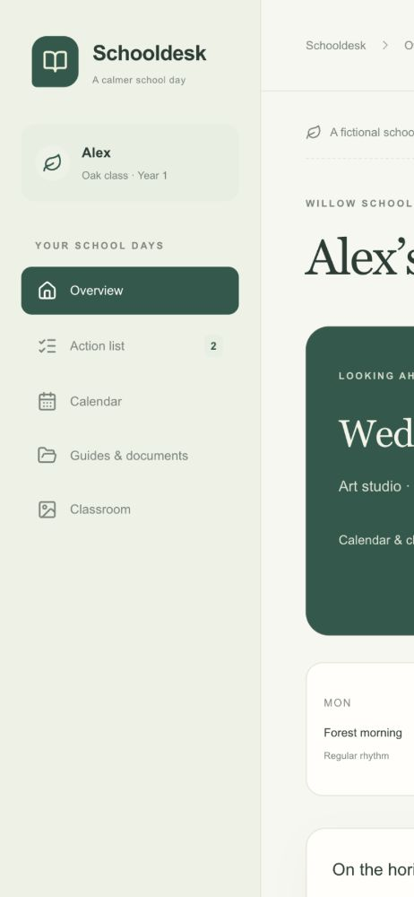

# Schooldesk

A calmer place for your family’s school days. Calendar, clubs, practical guides,
class notes, memories and a shared action list in one private dashboard.

Schooldesk is an independent, self-hostable application. It requires no ChatGPT,
OpenAI Sites, AI subscription or school-platform account to run. Each deployment
belongs to **one family**; this is not a shared service for multiple families.



## Try the fictional demo

**Fictional data only. No school account needed.**

To run the same demo locally:

Use Node.js 22.13 or later (Node 24 recommended).

```sh
npm ci
npm run demo
```

Open **http://localhost:3210**. All names, school information, dates and
illustrations are fictional. Demo notes stay in your browser. The public demo
cannot read or write a private database, accept uploads, or create accounts.

The same dashboard components can be built as an optional static preview.
That fictional preview has no server, database or school connection. `npm run build:demo` generates
that fictional preview in the ignored `demo-dist/` directory. GitHub Pages is
only suitable for this public demo, never a real family’s private dashboard.

## Make a private school desk

```sh
npm ci
npm run setup
npm run dev
```

Setup generates local secrets, creates the database and asks for an owner email,
name and password. Open **http://localhost:3000** and sign in. New installations
start empty; they are never populated with demonstration school content.

Add another parent with `npm run member:add`. Choose `viewer` for someone who
can read everything and share notes, but cannot import catalogues or upload
files. There is no public registration. `npm run member:remove` revokes access
even for an existing session. Members can change their password through the
authenticated Better Auth API; a server operator can recover an account using
the [account recovery procedure](docs/hosting.md#account-recovery).

Prepare a JSON catalogue using [the import guide](docs/importing.md), then import
it in **Updates & settings** or with `npm run import -- private/catalogue.json`.
The profile, school, class, timezone, house, weekend days and evening cutoff come
from that catalogue; no child or school identity is built into application code.

## What is included

- A day overview that looks ahead after a configurable evening cutoff.
- One calendar for school events, clubs and weekdays off, with past events.
- Clear web guides, tables and optional downloads of private originals.
- Class notices and a photo/video viewer with arrows, swipe and fitted media.
- Shared notes and completed actions preserved across content imports.
- Light, dark and system themes, iPhone navigation and home-screen icons.
- Source-check timestamps, publication history and visible failed imports.
- Invitation-only login using Better Auth, SQLite or PostgreSQL persistence.
- A validated JSON import API and independent command-line importer.
- Synthetic fixtures, security tests, a release-content check and an optional CI workflow.

## Hosting

**Local or container:** SQLite stores everything under the ignored `.data/`
directory. Keep it on a persistent private volume and back it up.

**Vercel:** standard Next.js deployment, using your own persistent PostgreSQL
database. The fictional demo requires no database. Private mode refuses SQLite
on Vercel because local function storage is ephemeral. See
[hosting instructions](docs/hosting.md) for environment variables and migrations.

There is no paid service dependency for local hosting. Free hosted plans have
their own eligibility and usage limits; this repository does not create accounts,
purchase services, provision a database or promise free hosting indefinitely.

## Sync and school connections

This release imports **prepared JSON**. It does **not** log into ClassOwl, read
email or Dropbox, extract arbitrary PDFs, or automatically crawl a school site.
No schedule is installed. Original uploads and media are limited to **3 MB per
file** in this first release; larger video storage and external archive connectors
are future work.

An independent producer can use `npm run sync -- private/catalogue.json` to
publish to an installation. The importer validates content, checks the current
version, publishes atomically and reads the result back. A bad import leaves the
last good catalogue and all family notes intact. An optional external scheduler
can invoke that command; it does not itself fetch new school content.

School-platform integration requires confirmation of permitted access and data
use. A parent’s login is not permission to redistribute school documents or
other children’s information. ClassOwl integration is deliberately outside this
release; see [the connector contract](docs/connectors.md).

## Development and contributions

```sh
npm run typecheck
npm test
npm run check:release
npm audit --omit=dev
npm run build
npm run test:http
```

Start with [architecture](docs/architecture.md), [security](SECURITY.md) and
[contribution guidelines](CONTRIBUTING.md). Use fictional fixtures in issues,
screenshots and pull requests. Never upload your school catalogue or credentials.

The code and original demonstration artwork are MIT licensed. Third-party
dependencies retain their own licences; see [notices](THIRD_PARTY_NOTICES.md).
No school logo, school document, private source archive or family data is licensed
or distributed by this repository.
